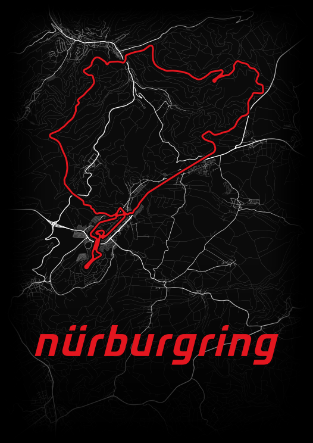
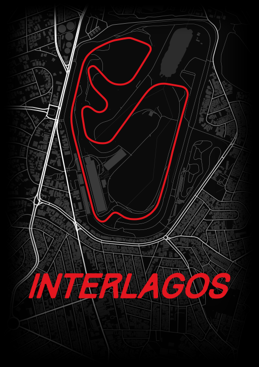

# Race-track A3 posters (street map print-out + 3D-printed track and letters)

| Nürburgring | Interlagos |
|---|---|
|  |  |

How the Nürburgring and Interlagos posters were made, written so another session can
reproduce them exactly or build a new track the same way. Last updated 2026-11-13.

## What the project is

An A3 portrait print-out (297 × 420 mm) of a black street map that fades to black at the
borders. A 3D-printed track outline (top) and the circuit's wordmark letters (bottom) are
glued on top. The print-out shows both in red as gluing guides, drawn 0.4 mm smaller per
side than the real parts so no red shows around the glued pieces.

## Folders

```
README.md                        this file
requirements.txt                 pinned Python packages
nurburgring/
  build.py                       generates everything below
  data/raceway.json              OSM raceway ways (track geometry)
  data/map.json                  OSM streets, buildings, water, rail
  data/nurburgring_logo.svg      official logo (vector)
  background_A3_dark.pdf/.png    print-out (vector PDF, 300 dpi PNG)
  background_A3_dark_preview.png small preview
  track.stl, letters.stl
interlagos/                      same layout; logo is data/interlagos_logo.png
```

## Reproduce exactly

The downloaded data is saved in each `data/` folder, so no network is needed.

```sh
python3 -m venv .venv            # built with Python 3.14.6
.venv/bin/pip install -r requirements.txt
.venv/bin/python nurburgring/build.py
.venv/bin/python interlagos/build.py
```

`build.py` writes its outputs
next to itself and prints the track/letter bounding boxes and STL watertightness.

Expected output sizes:

| | track.stl (mm) | letters.stl (mm) | letter pieces |
|---|---|---|---|
| Nürburgring | 204.8 × 213.7 × 6 | 232 × 38.4 × 6 | 14 |
| Interlagos | 136.3 × 213.1 × 6 | 232 × 30.3 × 6 | 10 |

## Final settings (constants at the top of each build.py)

| Constant | Nürburgring | Interlagos | Meaning |
|---|---|---|---|
| `SCALE` | 30000 | 5000 | map scale 1:N |
| `TRACK_TOP` | 42.0 | 42.0 | mm from page top to track's north edge |
| `TRACK_W` | 2.5 | 3.0 | printed track width, mm |
| `TRACK_Z` | 6.0 | 6.0 | printed track height, mm |
| `LET_W` | 232.0 | 232.0 | wordmark width, mm |
| `LET_CY` | 327.0 | 327.0 | wordmark centre, mm from page top |
| `LET_Z` | 6.0 | 6.0 | letter height, mm |
| `GUIDE_INSET` | 0.4 | 0.4 | red guides smaller than parts by this, per side |
| `RED` | #e3161f | #e3161f | guide colour |
| `RW` (road widths, mm) | 0.75, 0.6, 0.45, 0.28, 0.18, 0.15, 0.1 | 1.3, 1.1, 0.85, 0.55, 0.3, 0.25, 0.18 | by road class, major → path |

Only the dark theme is rendered (`render('dark')`); the user rejected the light version.

## Data sources

All OSM data came from the Overpass API with `out tags geom;`. `overpass-api.de` and
`overpass.kumi.systems` were returning 502 "at capacity"; `overpass.private.coffee`
worked. Use a generic User-Agent with no personal details.

**Nürburgring**

- Track: `way["highway"="raceway"](50.31,6.90,50.40,7.03);`
- Map: bbox `50.255,6.86,50.425,7.07`, ways with `highway`, `waterway`, `railway`,
  `building`, and `natural=water`.
- Logo: English Wikipedia `File:Nurburgring.svg`
  (`https://upload.wikimedia.org/wikipedia/en/4/49/Nurburgring.svg`). The letters are the
  path whose style contains fill `#ed1b24` (17 subpaths, even-odd fill).

**Interlagos**

- Track: `way["highway"="raceway"](-23.72,-46.715,-23.69,-46.68);`
- Map: bbox `-23.724,-46.712,-23.690,-46.681`, same feature set plus
  `relation["natural"="water"]` (relations are fetched but not drawn).
- Logo: Portuguese Wikipedia `Ficheiro:Autódromo de Interlagos logo.png`
  (`https://upload.wikimedia.org/wikipedia/pt/a/a1/Aut%C3%B3dromo_de_Interlagos_logo.png`),
  500 × 128 px RGBA. Not confirmed to be the circuit's current official logo; only
  Wikipedia was checked. No vector version was found.

## How build.py works

1. **Track selection** from `raceway.json`:
   - Nürburgring: keep everything except ways whose name starts with `Boxengasse`,
     `Rally`, `Variante 24h`, `Müllenbachschleife`, `Anbindung zum GP`, and unnamed or
     "Sprint" ways whose id ends in 1209, 1211, 9622, 9326, 8498, 5673, 5668. Result is
     Nordschleife + full GP circuit. The way named `Steilstrecke` must be kept: it is the
     main track through the Karussell (dropping it leaves a gap).
   - Interlagos: keep `sport=motor` ways, drop name `Pit Lane` and way ids 189535481
     (pit-entry link) and 638329117 (Bico de Pato shortcut). Karting and drag strip go
     because they are not `sport=motor`.
2. **Projection**: local equirectangular, metres → mm at `SCALE`. Page origin top-left,
   y down. Track is centred horizontally on the page; its north edge sits at `TRACK_TOP`.
3. **Track shape**: each way buffered by `TRACK_W/2` (round joins, resolution 16),
   unioned, closed with `buffer(0.25).buffer(-0.25)`, holes under 1.5 mm² filled.
4. **Letters**:
   - Nürburgring: SVG path sampled (24 points per curve segment), subpaths combined with
     symmetric difference for even-odd fill.
   - Interlagos: alpha channel of the PNG cropped to `(183, 28, 500, 77)` (the
     "INTERLAGOS" row; the "+QUE UM AUTÓDROMO" tagline is left out), upscaled 12×
     bicubic, Gaussian blur radius 12 × 0.45, contoured at 0.5 with contourpy, even-odd
     combined, then smoothed with `buffer(0.12).buffer(-0.24).buffer(0.12).simplify(0.03)`
     in pixel units. Edges are slightly soft because the source is tiny.
   - Both: scaled to `LET_W`, centred horizontally, vertical centre at `LET_CY`.
5. **STL**: page coordinates flipped to y-up, each polygon extruded with
   `trimesh.creation.extrude_polygon`, concatenated, exported. Coordinates stay in page
   millimetres, so track and letters keep their relative positions.
6. **Background**: matplotlib figure at exactly A3, full-bleed axes in mm.
   - Draw order: water, buildings, rail, then roads from paths up to motorways.
   - Dark theme: background `#0b0b0b`, buildings `#3a3a3a`, water `#2c2c2c`, roads from
     `#ffffff` (major) down to `#4c4c4c` (paths).
   - Fade: a black RGBA overlay whose visibility is
     `smooth(5,52,x) * smooth(5,52,W-x) * smooth(4,40,y) * (0.12 + 0.88*smooth(15,175,H-y)) * smooth(4,30,H-y)`
     (smoothstep, mm from each edge). The outer 4–5 mm is solid black; the bottom fades
     more heavily so the letters sit on a nearly black area.
   - Guides on top of the fade: a 0.7 mm background-colour halo around the track, then
     track and letters in `RED`, each shrunk by `GUIDE_INSET`.
   - Saved as PDF (vector), PNG at 300 dpi, and a 45 dpi preview.

## Decisions the user made along the way

- Track geometry is the real OSM layout, not the stylised outline in the logo, so it
  lines up with the streets.
- Dark version only.
- Track moved down (`TRACK_TOP` 26 → 42) and made wider and taller in steps:
  Nürburgring width 1.6 → 2.0 → 2.5 mm, Interlagos 2.0 → 3.0 mm, heights 3 → 6 mm.
  "Thicker" means width and "taller" means height; the outline size was not to change.
- Printed guides must be smaller than the parts (`GUIDE_INSET`), for track and letters.
- The frame has 30 mm of free depth.
- Nothing had been printed as of 2026-11-12.

## Known limits and open items

- Nürburgring at 2.5 mm: the GP section's parallel legs and southern hairpin fuse into a
  solid shape. 2.0 mm is the widest setting that keeps them separate.
- Interlagos letters are a raster trace; redo from a vector logo if one turns up.
- The PDFs have no bleed. For edge-to-edge printing a 303 × 426 mm version with 3 mm of
  black bleed was offered but not built. The shop must print at 100%, no scaling, or the
  guides will not match the parts.
- STLs were checked for watertightness only, not sliced or test-printed. The printer is
  a Creality K1 Max (300 × 300 mm bed); all parts fit.
- Loose letter pieces: ü dots and i dot on the Nürburgring wordmark.

## Making a new track the same way

1. Fetch `highway=raceway` ways for the circuit's bounding box into `data/raceway.json`
   and list them by name, sport and id. Plot them with ids to decide which to drop (pit
   lanes, karting, shortcuts, alternative layouts).
2. Pick `SCALE` so the track's larger dimension is about 205–213 mm.
3. Fetch the map data for a box covering the page: 297 × 420 mm at that scale, with the
   track's north edge 42 mm below the top, plus some margin.
4. Find the official logo, preferring an SVG. Copy `nurburgring/build.py` for an SVG
   logo or `interlagos/build.py` for a raster one, and adjust the track filter, the
   logo path/crop, `SCALE` and, for large scales, the `RW` road widths.
5. Run it, then look at the preview and at 300 dpi crops of the track and letters before
   handing anything over.

## Attribution

- Map and track data © OpenStreetMap contributors, available under the Open Database
  License (ODbL). The files in `data/*.json` and the rendered maps are derived from it.
- The Nürburgring and Interlagos names and logos are trademarks of their respective
  owners. The logo files and the letter shapes derived from them are included for
  personal, non-commercial use only; this project is not affiliated with either circuit.
